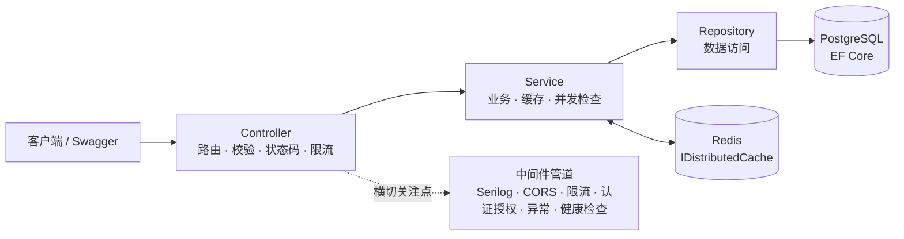

# 核心知识点 · 基础篇（Step 01~17.9）

> 第一阶段（2026-11-02 ~ 11-05）：项目从零到 JWT 策略授权，八大基础主题全通。
> 配套：[工程化进阶篇](02-工程化进阶-Step18-24.md) · [问题与路线图](03-问题清单与学习路线图.md) · [对话索引](05-学习对话索引.md)

---

## 一、项目总览

基于 ASP.NET Core 的订单管理 Web API 示例项目。初版覆盖 8 大主题，第二阶段（Step 18~24）补齐了**缓存、测试、部署、CI、安全、并发**六大工程化能力：

| # | 主题 | 对应代码位置 |
| --- | --- | --- |
| 1 | 分层架构（Controller → Service → **Repository** → DbContext） | `Controllers/OrdersController.cs`、`Services/Orders/` |
| 2 | EF Core 数据访问与迁移 | `Data/`、`Entities/`、`Migrations/` |
| 3 | 依赖注入（DI）三种生命周期 | `Services/OperationService.cs`、`Controllers/LifecycleController.cs` |
| 4 | Options 配置模式 | `Settings/OrderSettings.cs`、`Controllers/OptionsExperimentController.cs` |
| 5 | Serilog 结构化日志 | `Program.cs` L23-38 |
| 6 | 全局异常处理 | `Exceptions/GlobalExceptionHandler.cs` |
| 7 | JWT 认证 + 基于策略的授权 | `Controllers/AuthController.cs`、`Program.cs` L139-176 |
| 8 | OpenAPI / Swagger 文档 | `Program.cs` L187-240 |
| 9 | **Redis 分布式缓存（Cache-Aside + 空值缓存）** | `Services/Orders/OrderService.cs` |
| 10 | **测试体系（xUnit + Moq 单测 + WebApplicationFactory 集成测试）** | `tests/OrderManagement.Tests/` |
| 11 | **Docker 化（多阶段 Dockerfile + Compose + 数据卷迁移）** | `Dockerfile`、`compose.yaml`、`.env` |
| 12 | **CI/CD（GitHub Actions：restore → build → test）** | `.github/workflows/dotnet-ci.yml` |
| 13 | **限流 + CORS + 健康检查（live/ready）** | `Program.cs` L88-130、`HealthChecks/` |
| 14 | **乐观并发控制（Version → xmin，409 Conflict）** | `OrderService.UpdateAsync`、`ApplicationDbContext` |
| 15 | **代码质量（Roslyn 分析器 + CodeQL + NuGet 漏洞扫描）** | csproj `EnableNETAnalyzers` |



---

## 二、核心知识点笔记

### 1. 分层架构与依赖注入

- **Controller 只做三件事**：接收请求 DTO、调用 Service、返回状态码（201/204/404/400）。业务逻辑下沉到 `IOrderService` / `OrderService`。
- 通过**构造函数注入**获得 `ApplicationDbContext`、`ILogger<T>`、`IOrderService`。
- 注册位置在 `Program.cs`：`builder.Services.AddScoped<IOrderService, OrderService>();`
- 项目开启了严格 DI 校验（`Program.cs` L179-183）：

```csharp
builder.Host.UseDefaultServiceProvider(options =>
{
    options.ValidateScopes = true;     // Scope 内解析 Singleton 之外的错误在启动时暴露
    options.ValidateOnBuild = true;    // 启动时就校验所有服务能否构建
});
```

> 学习要点：`ValidateScopes` 在 Development 下默认开启，能把「Scoped 服务被注入到 Singleton」这类运行期才爆的问题提前到启动期。

### 2. DI 三种生命周期（LifecycleController 实验）

同一个 `OperationService`（内部 `Guid _id = Guid.NewGuid()`）分别注册为三种生命周期，通过 `GetOperationId()` 返回的 Guid 是否相同来观察：

| 生命周期 | 同一请求内两次解析 | 不同请求之间 | 典型用途 |
| --- | --- | --- | --- |
| **Transient** | ❌ 不同实例 | 不同实例 | 无状态的轻量服务 |
| **Scoped** | ✅ 同一实例 | 不同实例 | `DbContext`、每请求业务服务 |
| **Singleton** | ✅ 同一实例 | ✅ 同一实例 | 缓存、配置监控、`IOptionsMonitor` |

- `LifecycleController` 还演示了从 `IServiceProvider` 手动 `GetRequiredService<T>()` 解析（等价于构造注入，但应优先用构造注入）。
- ⚠️ **陷阱**：不要把 Scoped 服务注入 Singleton（captive dependency），也不要在 Singleton 里使用 `ApplicationDbContext`。

### 3. EF Core 数据访问

**实体与映射**

- `Order` 实体：`Id`、`OrderNo`、`CustomerName`、`TotalAmount`、`Status`（枚举）、`CreatedAt`、`UpdatedAt`、`Version`（第二阶段新增，见进阶篇）。
- Fluent API 在 `ApplicationDbContext.OnModelCreating` 中配置 **OrderNo 唯一索引**：

```csharp
modelBuilder.Entity<Order>()
    .HasIndex(x => x.OrderNo)
    .IsUnique();
```

**查询实践（OrdersController.GetList 是最佳范本）**

1. 分页参数校验（`pageIndex >= 1`，`1 <= pageSize <= 100`）→ 400 Bad Request；
2. `CountAsync()` 查总数；
3. **`AsNoTracking()`**：只读查询不追踪实体，减少变更追踪开销；
4. `OrderByDescending(CreatedAt).ThenByDescending(Id)`：**稳定排序**，避免同时间戳分页抖动；
5. `Skip().Take()` 生成 SQL 分页；
6. **`Select()` 投影到 DTO**：只取需要的字段，避免 SELECT * ；
7. `Math.Ceiling(totalCount / (double)pageSize)` 计算总页数；
8. 组装 `OrderListResponse { TotalCount, PageIndex, PageSize, TotalPages, Items }`。

**调试技巧**

```csharp
_logger.LogInformation("Pending Orders SQL: {Sql}", query.ToQueryString());
```
`ToQueryString()` 直接打印 LINQ 将要执行的 SQL —— 排查「生成的 SQL 不符合预期」神器。

**迁移（Migration）时间线 —— 你的学习路径本身就是笔记**

| 日期 | 迁移 | 学到的知识点 |
| --- | --- | --- |
| 11-02 | `InitialCreate` | `dotnet ef migrations add` 初始建表 |
| 11-02 | `AddOrderRemark` → `RemoveOrderRemark2` | 加字段后又删掉，学会 `RemoveMigration` / 重新 add |
| 11-02 | `updateOrderStatus`、`updateRemarkdefault` | 修改枚举列、给字段设默认值 |
| 11-03 | `updatetableOrder` | 调整表结构 |
| 11-03 | `addsourcefield` → `removesourcefield` | 加了又删，理解迁移是「历史记录不可随意篡改」 |
| 11-04 | `AddOrderNoUniqueIndex` | 给已有数据的表加唯一索引（配合 Fluent API） |

> 心得：迁移一旦 `database update` 提交到共享库，尽量**不要改历史迁移文件**，而是继续 `add` 新迁移 —— 你 11-03 的 add/remove 来回正好验证了这个流程。

### 4. Options 配置模式

三种注入方式对比（`OptionsExperimentController` 专门做了实验）：

| 接口 | 生命周期 | 配置变更时 | 适用场景 |
| --- | --- | --- | --- |
| `IOptions<T>` | Singleton | ❌ 不变（缓存） | 读一次就不变的配置 |
| `IOptionsSnapshot<T>` | Scoped | ✅ 下一请求生效 | Web 请求内读取 |
| `IOptionsMonitor<T>` | Singleton | ✅ 实时 + 可挂 `OnChange` 回调 | 需要热更新的配置 |

- 注册：`builder.Services.Configure<OrderSettings>(builder.Configuration.GetSection("OrderSettings"));`
- `SettingsController` 演示最简用法（`IOptions<OrderSettings>`）。

### 5. Serilog 结构化日志

`Program.cs` 中 `builder.Host.UseSerilog(...)`：

- **Sink**：控制台 + 文件 `logs/order-.log`，按天滚动，单文件 10MB，保留 30 个；
- **级别过滤**：默认 Information，把 `Microsoft.AspNetCore` 和 `EntityFrameworkCore` 噪音降到 Warning；
- **结构化占位符**（不是字符串插值！）：

```csharp
_logger.LogInformation("开始创建订单，订单编号：{OrderNo}", request.OrderNo);
_logger.LogError(exception, "Unhandled exception occurred. TraceId: {TraceId}", traceId);
```

> `{OrderNo}` 这种写法让 Serilog 能把字段结构化输出（JSON 日志里可检索），而不是把值拼进消息文本。**这是 Serilog 与普通 `Log.Information($"...")` 的本质区别。**

### 6. 全局异常处理

.NET 8+ 的 `IExceptionHandler` 模式（替代旧的 `UseMiddleware` 自定义异常中间件）：

1. `Program.cs` 注册：`AddProblemDetails()` + `AddExceptionHandler<GlobalExceptionHandler>()` + 管道中 `app.UseExceptionHandler()`；
2. `GlobalExceptionHandler.TryHandleAsync` 三步：记 `LogError`（带 TraceId）→ 构造统一 `ProblemDetails` → 写回 500 JSON；
3. 返回 `true` 表示异常已处理，框架不再继续抛出。

- 验证方式：`GET /api/orders/test-error` → 观察 `logs/order-*.log` 里的完整堆栈 + 接口返回统一 500 结构。

### 7. JWT 认证与授权

**登录签发（AuthController）**

- 演示账号 `admin / 123456`（仅学习用！）；
- Claims 打包：`NameIdentifier`、`Name`、`Role=Admin`、`permission=order.read`、`permission=order.manage`；
- `SymmetricSecurityKey` + `HmacSha256` 签名，过期时间取自 `Jwt:ExpirationMinutes`。

**校验（Program.cs）**

- `TokenValidationParameters`：校验 Issuer / Audience / Lifetime / 签名密钥，**`ClockSkew = 30 秒`**（默认 5 分钟太宽，收紧到 30s 是好习惯）；
- `RoleClaimType = ClaimTypes.Role` 让 `[Authorize(Roles = "Admin")]` 能正确匹配。

**三级授权实验**

| 写法 | 含义 | 示例端点 |
| --- | --- | --- |
| `[Authorize]` | 仅需登录 | `GET /api/orders/secure` |
| `[Authorize(Roles = "Admin")]` | 需 Admin 角色 | `GET /api/orders/admin` |
| 命名策略 | `RequireRole` / `RequireClaim` 组合 | `Program.cs` 中的 `AdminOnly`、`OrderRead`、`OrderManage` |

策略注册示例：

```csharp
options.AddPolicy("OrderManage", policy =>
    policy.RequireRole("Admin")
          .RequireClaim("permission", "order.manage"));
```

**敏感配置**：`Jwt:SecretKey` 等放在 **user-secrets**（`dotnet user-secrets list` 可见），不进 Git —— `appsettings.json` 里只留非敏感项，这是正确的做法。

### 8. OpenAPI 文档的 JWT 集成

.NET 9/10 内置 OpenAPI（不再是 Swashbuckle 生成文档，仅保留 SwaggerUI 壳）：

- `AddDocumentTransformer`：注册 `Bearer` 安全方案定义；
- `AddOperationTransformer`：读取每个 Action 的 `EndpointMetadata`，**只有带 `[Authorize]` 且非 `[AllowAnonymous]` 的接口才挂 SecurityRequirement** —— 这样匿名接口不会出现锁图标。

### 9. HTTP 状态码约定（已内化成习惯）

| 场景 | 返回 |
| --- | --- |
| 创建成功 | `201 Created`（`StatusCode(201, order)`） |
| 更新/删除成功 | `204 No Content` |
| 资源不存在 | `404 NotFound()` |
| 参数非法 | `400 BadRequest(消息)` |
| 未认证 / 密码错误 | `401 Unauthorized` |
| 未处理异常 | `500` + ProblemDetails JSON |
| **并发版本冲突** | **`409 Conflict`**（`DbUpdateConcurrencyException` → `Conflict()`） |
| **触发限流** | **`429 Too Many Requests`**（`RejectionStatusCode`） |
| **已认证但无权限** | **`403 Forbidden`** |
