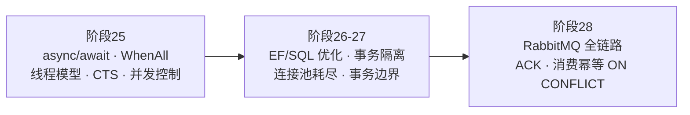
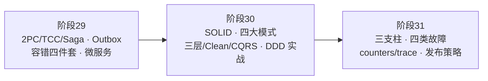

# 问题清单与学习路线图

> 更新时间：2026-11-24 · 当前状态：**23/31 测试通过**（8 个失败，根因已定位）
> 配套：[基础篇](01-核心知识点-基础篇.md) · [进阶篇](02-工程化进阶-Step18-24.md) · [面试准备](06-高级岗位与面试准备.md) · [对话索引](05-学习对话索引.md)

---

## 三、问题清单（2026-11-24 更新）

### 🔴 紧急：8 个测试失败（根因已定位）

| 失败测试 | 根因 |
| --- | --- |
| `OrdersApiTests` 全部 6 个（404/201/400/401/403/200） | **`ObjectDisposedException: TestServer`** —— 新增的 `OrderCreatedConsumer`（RabbitMQ BackgroundService）在 Testing 环境启动失败：RabbitMQ 配置只在 `appsettings.Development.json`，Testing 环境读不到 → consumer 连接异常 → **HostedService 抛异常把 Host 拖垮** → TestServer 被释放 | 
| `OrderServiceTests.UpdateAsync_WhenOrderExists_...` | 乐观并发 Version 检查与测试数据不匹配（11-17 遗留） |
| `UnitTest1.PaidOrder_ShouldNotAllowAddingItem` | `Assert.Throws()` 要求**精确类型**，实际抛的不是 `InvalidOperationException`（Domain 抛的是 `BusinessException`）—— 改类型或用 `Assert.ThrowsAny<>` |

**修复方向**（三选一或组合）：
1. Testing 环境给 RabbitMQ 配置 + `CustomWebApplicationFactory` 里 `RemoveAll<IHostedService>()` 跳过 consumer（推荐，测试不该依赖 MQ）
2. consumer 里对连接失败做容错（不抛致命异常）
3. 把 RabbitMQ 配置挪到 `appsettings.json`（Testing 也能读到）

### ✅ 已解决（前两轮累计）

| 问题 | 解决 |
| --- | --- |
| Create 不落库 / Controller 直连 DbContext / 缺校验 / 无并发保护 / 无测试 | Repository 重构 + DataAnnotations + xmin 乐观并发 + 25 测试（11-17） |

### ⚠️ 待办（按优先级）

| # | 问题 | 说明 |
| --- | --- | --- |
| 1 | **修 8 个失败测试**（见上表） | 跑绿 `dotnet test` 再继续 |
| 2 | 提交未跟踪文件：`ordermanagement.nettrace`（16.9MB！）+ `speedscope.json` | ⚠️ 二进制大文件**不应进 Git** → 加进 `.gitignore`，必要时留 speedscope |
| 3 | Pkcs 漏洞升级（NU1903，11-17 遗留） | `dotnet add package System.Security.Cryptography.Pkcs --version 10.0.14` |
| 4 | CodeQL `cs/log-forging` 2 个告警未修 | `LogSanitizer.Sanitize()` 转义 |
| 5 | Producer 每次消息新建连接 | 生产要复用连接 + Publisher Confirms |
| 6 | `requeue:false` 无 DLX 会丢消息 | 概念已学，按节奏暂不实操（阶段 29 策略） |
| 7 | Step 24 幂等性 HTTP 版（Idempotency-Key） | 消息版已完成，HTTP 版只讲了设计 |
| 8 | 登录仍无用户表；`WeatherForecast` 残留；`dotnet-counters` PATH | 长期小项 |

---

## 四、学习路线图（七阶段全景）

### ✅ 阶段一：基础八件套（11-02 ~ 11-05，Step 01~17.9）
分层 / EF Core / DI / Options / Serilog / 全局异常 / JWT 授权 / OpenAPI → [基础篇](01-核心知识点-基础篇.md)

### ✅ 阶段二：工程化六大能力（11-06 ~ 11-17，Step 18~24）
Redis 缓存 / Repository / 测试 / Docker / CI / 限流健康检查 / 乐观并发 / 代码质量 → [进阶篇](02-工程化进阶-Step18-24.md)

### ✅ 阶段三：异步编程 + 消息队列（11-18 ~ 11-21，Step 25~28）

→ [07 异步编程](07-CSharp异步编程-阶段25.md) · [08 消息队列与幂等](08-消息队列与幂等-阶段28.md)

### ✅ 阶段四：分布式 + DDD + 可观测性（11-21 ~ 11-23，Step 29~31）

→ [09 分布式与架构](09-分布式与架构-阶段29-30.md) · [10 DDD 实战](10-DDD实战-阶段30.md) · [11 可观测性诊断](11-可观测性与诊断-阶段31.md)

### 🚧 阶段五：当前（Step 32 综合面试 + 收尾）

**收尾（见问题清单 1~3，先做）**：
- [ ] 修 8 个失败测试（TestServer disposed 根因）→ 跑绿 `dotnet test`
- [ ] `.gitignore` 掉 nettrace 大文件
- [ ] Pkcs 升级 + CodeQL 复扫

**主线（对话 21 已明确的计划）**：
- [ ] **C# 核心基础复习 3~4 节**：值/引用类型、装箱、委托与事件、LINQ、`IEnumerable` vs `IQueryable`、`IDisposable`、GC 分代
- [ ] **项目架构介绍练习**：开放式介绍 OrderManagement（两种架构对照：`/api/orders` vs `/api/ddd/orders`）
- [ ] 补 **API Gateway（Ocelot/YARP）**、服务发现、负载均衡
- [ ] 阶段 32 综合面试题训继续（9 阶段路线已完成 8/9）

### 📈 阶段六：未来 1~2 个月

- [ ] Hangfire 订单超时取消（Outbox 已具备基础）
- [ ] OpenTelemetry → Jaeger 链路追踪（阶段 31 已学概念）
- [ ] Testcontainers 用真 PostgreSQL 跑集成测试（替代 InMemory 的并发局限）
- [ ] 系统设计限时练习：「设计订单系统」（全项目素材直接复用）

### 🎯 阶段七：2~3 个月进阶选题

| 方向 | 关键词 |
| --- | --- |
| 深入 | CLR 源码、GC 调优、EF Core 二级缓存、BenchmarkDotNet |
| 分布式 | Kafka、Saga 编排器、Service Mesh（**已明确暂不深入**） |
| 架构 | 完整 Clean Architecture 重构、事件溯源 |
| 前后端闭环 | React/Vue 消费本 API 或 Blazor |

> ⚠️ 对话 21 的盘点结论：**暂不深入 K8s、Service Mesh、CLR 源码** —— 优先把综合面试主线走完。

---

## 五、路线图元信息

- **9 阶段总路线进度：8/9 完成**（阶段 9 综合面试进行中）
- **三线并行**：综合面试主线（主）+ 知识点补充（穿插）+ 小型实战（巩固）
- 面试缺口清单（对话 21 自查）：C# 基础 ✗、API Gateway ✗、服务发现/负载均衡 ✗、Testcontainers ✗；已具备：异步/EF/事务/缓存/幂等/管线/架构/诊断
