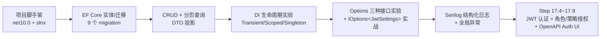
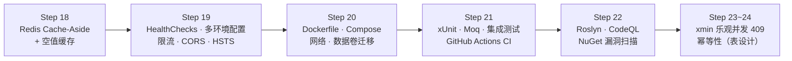

# 问题清单与学习路线图

> 更新时间：2026-11-17 · 当前状态：**24/25 测试通过**、13 个文件未提交
> 配套：[基础篇](01-核心知识点-基础篇.md) · [进阶篇](02-工程化进阶-Step18-24.md) · [面试准备](06-高级岗位与面试准备.md)

---

## 三、问题清单（更新版）

### ✅ 已在第二阶段解决

| 原问题 | 解决方式 |
| --- | --- |
| ⚠️ `CreateAsync` 不落库 | Repository 收口 `SaveChangesAsync()`（[进阶篇 §11](02-工程化进阶-Step18-24.md)） |
| Controller 直连 DbContext | 重构为 Controller → Service → Repository 三层，Controller 零 EF |
| 缺请求校验 | DTO 加 `[Required]`/`[StringLength]`/`[Range]`，`[ApiController]` 自动 400 |
| 无并发保护 | `Version` → xmin 乐观并发 + 409 Conflict（[进阶篇 §15](02-工程化进阶-Step18-24.md)） |
| 无测试 | 25 个测试：Moq 单测 + WebApplicationFactory 集成测试，CI 自动跑 |

### ⚠️ 当前待办（按优先级）

| # | 问题 | 位置 | 说明 |
| --- | --- | --- | --- |
| 1 | **1 个测试失败**：`UpdateAsync_WhenOrderExists_ShouldUpdateAndInvalidateCache` 抛 `DbUpdateConcurrencyException` —— 新加的 Version 检查与测试数据（Version=0）不匹配 | `OrderServiceTests.cs` L191 | 进行中工作：测试要传匹配的 `request.Version`，或 mock 返回带 Version 的实体 |
| 2 | **13 个文件未提交**（乐观并发改造 + OrderDetailDto） | git status | 完成 #1 后一起提交，如 `feat: 乐观并发控制与 OrderDetailDto` |
| 3 | **Pkcs 漏洞未升级**（NU1903 高危，传递依赖） | csproj | `dotnet add package System.Security.Cryptography.Pkcs --version 10.0.14`（需先解决 NuGet 代理网络问题） |
| 4 | **CodeQL 2 个 `cs/log-forging` 告警未修** | 日志语句 | 引入 `LogSanitizer.Sanitize()` 转义用户输入中的 `\r\n` |
| 5 | 登录无用户表，账号密码硬编码 | `AuthController.cs` | 后续接 EF 用户表 + `PasswordHasher` |
| 6 | 幂等性只完成了表设计（Step 24 被跳过） | — | `IdempotencyRecord` 表 + `Idempotency-Key` 头 + 同事务写入 |
| 7 | `WeatherForecast` 模板残留 | `Controllers/` | 可清理 |
| 8 | `dotnet-counters` 不在 PATH | 环境 | `echo 'export PATH="$HOME/.dotnet/tools:$PATH"' >> ~/.zshrc` |

---

## 四、学习路线图（五阶段）

### ✅ 阶段一：基础八件套（2026-11-02 ~ 11-05，Step 01~17.9）

### ✅ 阶段二：工程化六大能力（2026-11-06 ~ 11-17，Step 18~24）

### 🚧 阶段三：当前 → 未来 1~2 周（收尾 + 下一主线）

**收尾清单**（见问题清单 1~4）：
- [ ] 修复失败的 `UpdateAsync` 测试，跑绿 `dotnet test`
- [ ] 提交 13 个未提交文件
- [ ] 升级 Pkcs 修复 NU1903；复扫 CodeQL 修 log-forging
- [ ] 补 Step 24 幂等性实现（`Idempotency-Key` 中间件 + 同事务记录）

**下一主线（ChatGPT 已指定）**：
- [ ] **async/await、Task 与线程池**（面试第一优先级主题，见[面试准备](06-高级岗位与面试准备.md)）
- [ ] 软删除：`IsDeleted` + `modelBuilder.HasQueryFilter`
- [ ] 订单状态机：Pending → Paid → Canceled，非法流转返回 409

### 📈 阶段四：未来 1~2 个月（向生产级靠拢）

- [ ] Hangfire 做订单超时自动取消（对话中选定的任务调度框架；不替代 Outbox）
- [ ] 全局响应包装（统一 `{ code, message, data }`）+ 统一分页契约
- [ ] `Mapster`/`AutoMapper` 消除手写 DTO 映射
- [ ] FluentValidation 替代 DataAnnotations（复杂规则）
- [ ] Serilog Sink 到 Seq / ELK，体验结构化日志检索
- [ ] Refresh Token 轮换；OpenTelemetry 分布式追踪

### 🎯 阶段五：2~3 个月后的进阶选题

| 方向 | 关键词 |
| --- | --- |
| 性能 | Keyset 分页、`BenchmarkDotNet`、EF 二级查询、连接池调优 |
| 微服务化 | gRPC / 消息队列（订单事件）、API Gateway、OpenTelemetry |
| 前后端闭环 | React/Vue 前端消费本 API，或 Blazor |
| 架构风格 | DDD 分层（Domain/Application/Infrastructure）、Clean Architecture、CQRS |

> 详细的高级岗位技术地图与 2026 面试准备见 [06-高级岗位与面试准备.md](06-高级岗位与面试准备.md)。
