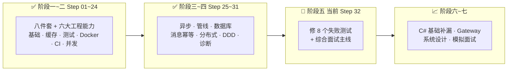

# OrderManagement 学习笔记与路线图

> 整理时间：2026-11-05（初版） · 2026-11-17（第二版：Step 18~24） · 2026-11-24（第三版：阶段 25~32 + 面试补充）
> 项目：ASP.NET Core 10 订单管理 Web API（学习项目）
> 学习周期：2026-11-02 ~ 2026-11-23 · 11 个 EF 迁移 · 主线 Step 01 → 32 · 累计 **24 个** ChatGPT 对话 · **9 阶段路线完成 8/9**
> 当前状态：**23/31 测试通过**（8 个失败根因已定位：RabbitMQ consumer 拖垮测试 Host）

---

## 📖 文档导航（13 个专题页）

| 页面 | 内容 | 适合场景 |
| --- | --- | --- |
| [01 · 核心知识点-基础篇](01-核心知识点-基础篇.md) | 项目总览 + 第一阶段 9 大主题：分层/DI/EF Core/Options/Serilog/异常/JWT/OpenAPI/状态码 | 复习基础八股 |
| [02 · 工程化进阶-Step18-24](02-工程化进阶-Step18-24.md) | Redis 缓存/Repository/测试/Docker/限流健康检查/乐观并发/代码质量 | 复习工程化实践 |
| [03 · 问题清单与学习路线图](03-问题清单与学习路线图.md) | 待办清单（含 8 个失败测试根因）+ **七阶段全景路线图** | 规划下一步 |
| [04 · 常用命令与速查](04-常用命令与速查.md) | 日常命令 + 验证路径 + CI/部署速查 | 每天开工前查 |
| [05 · 学习对话索引（前两批）](05-学习对话索引.md) | 1~13 号链接索引 + 两批摘要 | 回溯第一批对话 |
| [06 · 高级岗位与面试准备](06-高级岗位与面试准备.md) | 高级岗位 8 大领域技术地图 + 2026 面试策略 + **综合面试纠错与缺口清单** | 面试冲刺 |
| [07 · CSharp异步编程-阶段25](07-CSharp异步编程-阶段25.md) | async/await · WhenAll · 线程模型 · CTS · 并发控制（面试第一优先级） | 异步专题复习 |
| [08 · 消息队列与幂等-阶段28](08-消息队列与幂等-阶段28.md) | 连接池/事务边界 · RabbitMQ 全链路 · ACK · ON CONFLICT 幂等 | MQ 专题复习 |
| [09 · 分布式与架构-阶段29-30](09-分布式与架构-阶段29-30.md) | 2PC/TCC/Saga · Outbox · 容错四件套 · SOLID/四模式/三架构 | 架构面试复习 |
| [10 · DDD实战-阶段30](10-DDD实战-阶段30.md) | 聚合根/值对象/EF OwnsMany/领域事件/领域单测 | DDD 专题复习 |
| [11 · 可观测性与诊断-阶段31](11-可观测性与诊断-阶段31.md) | 三支柱 · 四类故障 · counters/trace · 发布策略/Expand-Contract | 诊断专题复习 |
| [12 · 请求管线与数据库进阶-阶段26-27](12-请求管线与数据库进阶-阶段26-27.md) | Middleware 洋葱模型/五种 Filter · 事务隔离/锁与防超卖/索引 EXPLAIN/Keyset | 管线与 SQL 面试复习 |
| [13 · 学习对话索引（第三批）](13-学习对话索引-第三批.md) | 14~24 号链接索引 + 分阶段摘要（344 条消息） | 回溯第二批对话 |

---

## 📍 一句话总览

> **当前进度锚点**：9 阶段路线完成 **8/9**，正在阶段 32「高级 .NET 后端综合面试」；
> 最优先三件事：**修 8 个失败测试（consumer 拖垮 TestServer）→ gitignore 掉 nettrace 大文件 → C# 核心基础复习**（详见 [问题清单](03-问题清单与学习路线图.md)）。

---

## 🔧 本项目已落地的 20+ 个主题

| # | 主题 | # | 主题 |
| --- | --- | --- | --- |
| 1 | 分层架构（Controller→Service→Repository） | 11 | Docker 化（多阶段 + Compose + 数据卷） |
| 2 | EF Core 数据访问与迁移 | 12 | CI/CD（GitHub Actions） |
| 3 | DI 三种生命周期 | 13 | 限流 + CORS + 健康检查 live/ready |
| 4 | Options 配置模式 | 14 | 乐观并发（xmin → 409 Conflict） |
| 5 | Serilog 结构化日志 | 15 | 代码质量（Roslyn + CodeQL + 漏洞扫描） |
| 6 | 全局异常处理 | 16 | **async/await 与并发控制（阶段 25）** |
| 7 | JWT 认证 + 策略授权 | 17 | **请求管线 Middleware/Filter（阶段 26）** |
| 8 | OpenAPI / Swagger | 18 | **事务隔离/锁/索引 EXPLAIN（阶段 27）** |
| 9 | Redis 分布式缓存（Cache-Aside + 空值缓存） | 19 | **RabbitMQ + 消费幂等（阶段 28）** |
| 10 | 测试体系（xUnit + Moq + 集成测试） | 20 | **分布式事务/Outbox/容错（阶段 29）** |
| 21 | **DDD 四层 + 领域事件（阶段 30）** | 22 | **可观测性 + 诊断工具 + 发布策略（阶段 31）** |
