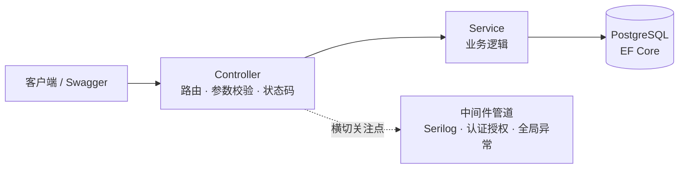
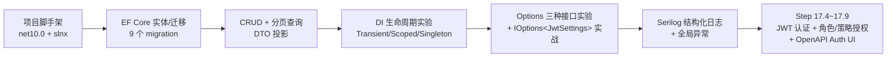
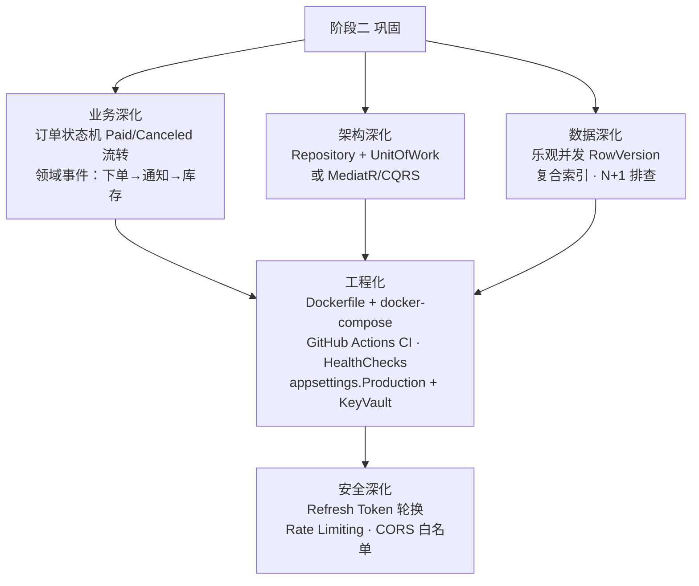

# OrderManagement 学习笔记与路线图

> 整理时间：2026-11-05
> 项目：ASP.NET Core 10 订单管理 Web API（学习项目）
> 学习周期：2026-11-02 ~ 2026-11-05（从 InitialCreate 到唯一索引，共 9 个 EF 迁移）

---

## 一、项目总览

基于 ASP.NET Core 的订单管理 Web API 示例项目，覆盖了一个 .NET 后端开发者日常最常用的 8 大核心主题：

| # | 主题 | 对应代码位置 |
| --- | --- | --- |
| 1 | 分层架构（Controller → Service → DbContext） | `Controllers/OrdersController.cs`、`Services/Orders/OrderService.cs` |
| 2 | EF Core 数据访问与迁移 | `Data/`、`Entities/`、`Migrations/` |
| 3 | 依赖注入（DI）三种生命周期 | `Services/OperationService.cs`、`Controllers/LifecycleController.cs` |
| 4 | Options 配置模式 | `Settings/OrderSettings.cs`、`Controllers/OptionsExperimentController.cs` |
| 5 | Serilog 结构化日志 | `Program.cs` L16-31 |
| 6 | 全局异常处理 | `Exceptions/GlobalExceptionHandler.cs` |
| 7 | JWT 认证 + 基于策略的授权 | `Controllers/AuthController.cs`、`Program.cs` L63-108 |
| 8 | OpenAPI / Swagger 文档 | `Program.cs` L119-172 |



---

## 二、核心知识点笔记

### 1. 分层架构与依赖注入

- **Controller 只做三件事**：接收请求 DTO、调用 Service、返回状态码（201/204/404/400）。业务逻辑下沉到 `IOrderService` / `OrderService`。
- 通过**构造函数注入**获得 `ApplicationDbContext`、`ILogger<T>`、`IOrderService`。
- 注册位置在 `Program.cs`：`builder.Services.AddScoped<IOrderService, OrderService>();`
- 项目开启了严格 DI 校验（`Program.cs` L111-115）：

```csharp
builder.Host.UseDefaultServiceProvider(options =>
{
    options.ValidateScopes = true;     // Scope 内解析 Singleton 之外的错误在启动时暴露
    options.ValidateOnBuild = true;    // 启动时就校验所有服务能否构建
});
```

> 学习要点：`ValidateScopes` 在 Development 下默认开启，能把「Scoped 服务被注入到 Singleton」这类运行期才爆的问题提前到启动期。

### 2. DI 三种生命周期（LifecycleController 实验）

同一个 `OperationService`（内部 `Guid _id = Guid.NewGuid()`）分别注册为三种生命周期，通过 `GetOperationId()` 返回的 Guid 是否相同来观察：

| 生命周期 | 同一请求内两次解析 | 不同请求之间 | 典型用途 |
| --- | --- | --- | --- |
| **Transient** | ❌ 不同实例 | 不同实例 | 无状态的轻量服务 |
| **Scoped** | ✅ 同一实例 | 不同实例 | `DbContext`、每请求业务服务 |
| **Singleton** | ✅ 同一实例 | ✅ 同一实例 | 缓存、配置监控、`IOptionsMonitor` |

- `LifecycleController` 还演示了从 `IServiceProvider` 手动 `GetRequiredService<T>()` 解析（等价于构造注入，但应优先用构造注入）。
- ⚠️ **陷阱**：不要把 Scoped 服务注入 Singleton（ captive dependency ），也不要在 Singleton 里使用 `ApplicationDbContext`。

### 3. EF Core 数据访问

**实体与映射**

- `Order` 实体：`Id`、`OrderNo`、`CustomerName`、`TotalAmount`、`Status`（枚举）、`CreatedAt`、`UpdatedAt`。
- Fluent API 在 `ApplicationDbContext.OnModelCreating` 中配置 **OrderNo 唯一索引**：

```csharp
modelBuilder.Entity<Order>()
    .HasIndex(x => x.OrderNo)
    .IsUnique();
```

**查询实践（OrdersController.GetList 是最佳范本）**

1. 分页参数校验（`pageIndex >= 1`，`1 <= pageSize <= 100`）→ 400 Bad Request；
2. `CountAsync()` 查总数；
3. **`AsNoTracking()`**：只读查询不追踪实体，减少变更追踪开销；
4. `OrderByDescending(CreatedAt).ThenByDescending(Id)`：**稳定排序**，避免同时间戳分页抖动；
5. `Skip().Take()` 生成 SQL 分页；
6. **`Select()` 投影到 DTO**：只取需要的字段，避免 SELECT * ；
7. `Math.Ceiling(totalCount / (double)pageSize)` 计算总页数；
8. 组装 `OrderListResponse { TotalCount, PageIndex, PageSize, TotalPages, Items }`。

**调试技巧**

```csharp
_logger.LogInformation("Pending Orders SQL: {Sql}", query.ToQueryString());
```
`ToQueryString()` 直接打印 LINQ 将要执行的 SQL —— 排查「生成的 SQL 不符合预期」神器。

**迁移（Migration）时间线 —— 你的学习路径本身就是笔记**

| 日期 | 迁移 | 学到的知识点 |
| --- | --- | --- |
| 11-02 | `InitialCreate` | `dotnet ef migrations add` 初始建表 |
| 11-02 | `AddOrderRemark` → `RemoveOrderRemark2` | 加字段后又删掉，学会 `RemoveMigration` / 重新 add |
| 11-02 | `updateOrderStatus`、`updateRemarkdefault` | 修改枚举列、给字段设默认值 |
| 11-03 | `updatetableOrder` | 调整表结构 |
| 11-03 | `addsourcefield` → `removesourcefield` | 加了又删，理解迁移是「历史记录不可随意篡改」 |
| 11-04 | `AddOrderNoUniqueIndex` | 给已有数据的表加唯一索引（配合 Fluent API） |

> 心得：迁移一旦 `database update` 提交到共享库，尽量**不要改历史迁移文件**，而是继续 `add` 新迁移 —— 你 11-03 的 add/remove 来回正好验证了这个流程。

### 4. Options 配置模式

三种注入方式对比（`OptionsExperimentController` 专门做了实验）：

| 接口 | 生命周期 | 配置变更时 | 适用场景 |
| --- | --- | --- | --- |
| `IOptions<T>` | Singleton | ❌ 不变（缓存） | 读一次就不变的配置 |
| `IOptionsSnapshot<T>` | Scoped | ✅ 下一请求生效 | Web 请求内读取 |
| `IOptionsMonitor<T>` | Singleton | ✅ 实时 + 可挂 `OnChange` 回调 | 需要热更新的配置 |

- 注册：`builder.Services.Configure<OrderSettings>(builder.Configuration.GetSection("OrderSettings"));`
- `SettingsController` 演示最简用法（`IOptions<OrderSettings>`）。

### 5. Serilog 结构化日志

`Program.cs` 中 `builder.Host.UseSerilog(...)`：

- **Sink**：控制台 + 文件 `logs/order-.log`，按天滚动，单文件 10MB，保留 30 个；
- **级别过滤**：默认 Information，把 `Microsoft.AspNetCore` 和 `EntityFrameworkCore` 噪音降到 Warning；
- **结构化占位符**（不是字符串插值！）：

```csharp
_logger.LogInformation("开始创建订单，订单编号：{OrderNo}", request.OrderNo);
_logger.LogError(exception, "Unhandled exception occurred. TraceId: {TraceId}", traceId);
```

> `{OrderNo}` 这种写法让 Serilog 能把字段结构化输出（JSON 日志里可检索），而不是把值拼进消息文本。**这是 Serilog 与普通 `Log.Information($"...")` 的本质区别。**

### 6. 全局异常处理

.NET 8+ 的 `IExceptionHandler` 模式（替代旧的 `UseMiddleware` 自定义异常中间件）：

1. `Program.cs` 注册：`AddProblemDetails()` + `AddExceptionHandler<GlobalExceptionHandler>()` + 管道中 `app.UseExceptionHandler()`；
2. `GlobalExceptionHandler.TryHandleAsync` 三步：记 `LogError`（带 TraceId）→ 构造统一 `ProblemDetails` → 写回 500 JSON；
3. 返回 `true` 表示异常已处理，框架不再继续抛出。

- 验证方式：`GET /api/orders/test-error` → 观察 `logs/order-*.log` 里的完整堆栈 + 接口返回统一 500 结构。

### 7. JWT 认证与授权

**登录签发（AuthController）**

- 演示账号 `admin / 123456`（仅学习用！）；
- Claims 打包：`NameIdentifier`、`Name`、`Role=Admin`、`permission=order.read`、`permission=order.manage`；
- `SymmetricSecurityKey` + `HmacSha256` 签名，过期时间取自 `Jwt:ExpirationMinutes`。

**校验（Program.cs）**

- `TokenValidationParameters`：校验 Issuer / Audience / Lifetime / 签名密钥，**`ClockSkew = 30 秒`**（默认 5 分钟太宽，收紧到 30s 是好习惯）；
- `RoleClaimType = ClaimTypes.Role` 让 `[Authorize(Roles = "Admin")]` 能正确匹配。

**三级授权实验**

| 写法 | 含义 | 示例端点 |
| --- | --- | --- |
| `[Authorize]` | 仅需登录 | `GET /api/orders/secure` |
| `[Authorize(Roles = "Admin")]` | 需 Admin 角色 | `GET /api/orders/admin` |
| 命名策略 | `RequireRole` / `RequireClaim` 组合 | `Program.cs` 中的 `AdminOnly`、`OrderRead`、`OrderManage` |

策略注册示例：

```csharp
options.AddPolicy("OrderManage", policy =>
    policy.RequireRole("Admin")
          .RequireClaim("permission", "order.manage"));
```

**敏感配置**：`Jwt:SecretKey` 等放在 **user-secrets**（`dotnet user-secrets list` 可见），不进 Git —— `appsettings.json` 里只留非敏感项，这是正确的做法。

### 8. OpenAPI 文档的 JWT 集成

.NET 9/10 内置 OpenAPI（不再是 Swashbuckle 生成文档，仅保留 SwaggerUI 壳）：

- `AddDocumentTransformer`：注册 `Bearer` 安全方案定义；
- `AddOperationTransformer`：读取每个 Action 的 `EndpointMetadata`，**只有带 `[Authorize]` 且非 `[AllowAnonymous]` 的接口才挂 SecurityRequirement** —— 这样匿名接口不会出现锁图标。

### 9. HTTP 状态码约定（已内化成习惯）

| 场景 | 返回 |
| --- | --- |
| 创建成功 | `201 Created`（`StatusCode(201, order)`） |
| 更新/删除成功 | `204 No Content` |
| 资源不存在 | `404 NotFound()` |
| 参数非法 | `400 BadRequest(消息)` |
| 未认证 / 密码错误 | `401 Unauthorized` |
| 未处理异常 | `500` + ProblemDetails JSON |

---

## 三、发现的问题（下一步改进清单）

| # | 问题 | 位置 | 影响 |
| --- | --- | --- | --- |
| ⚠️ 1 | **`CreateAsync` 没有调用 `SaveChangesAsync()`** —— `Add()` 只是把实体加入变更跟踪，不落库，接口返回 201 但数据库里没有数据 | `Services/Orders/OrderService.cs` | 订单创建实际未生效（原 Controller 里被注释掉的旧代码有 Save，重构时丢了） |
| 2 | Controller 直接注入 `ApplicationDbContext` 做增删改查，与 Service 层职责重叠 | `OrdersController.cs` | 学习期可接受；正式项目应统一走 Service/Repository |
| 3 | 登录无用户表，账号密码硬编码 | `AuthController.cs` | 学习期可接受，后续接 EF 用户表 + PasswordHasher |
| 4 | 缺少请求模型校验（`[Required]`/`[Range]` / FluentValidation） | `DTOs/` | 非法数据靠手写 if 判断 |
| 5 | 更新/删除无并发保护（乐观并发 `RowVersion`） | `OrdersController.cs` | 多人同时改会互相覆盖 |
| 6 | 无单元测试 / 集成测试 | — | 重构无安全网 |
| 7 | `WeatherForecast` 模板残留 | `Controllers/` | 可清理 |
| 8 | `dotnet-counters` command not found（`~/.dotnet/tools` 未进 PATH） | 环境 | 学习对话中遗留的未解决项：`echo 'export PATH="$HOME/.dotnet/tools:$PATH"' >> ~/.zshrc` |

---

## 四、学习路线图

### ✅ 阶段一：已完成（2026-11-02 ~ 11-05，对应 ChatGPT 主线 Step 1 ~ 17.9）



> 📍 **当前进度锚点**（来自 ChatGPT 学习对话）：Step 17.9 策略授权已完成、`AddAuthorization()` 已补齐；
> **下一步是 Step 18：Redis 缓存与 ASP.NET Core 缓存机制**（Step 18.1 IMemoryCache 已在对话中布置，代码尚未落到项目里）。

### 🚧 阶段二：当前 → 未来 1~2 周（巩固与补全）

1. **修复 Create 不落库的 Bug**（第 1 条问题），顺便在 Service 里引入 `SaveChangesAsync` 的异常处理（`DbUpdateException`）；
2. **🔧 Step 18 缓存主线（ChatGPT 已布置的下一步）**：
   - 18.1 `IMemoryCache`：`AddMemoryCache()` + `GetById` 注入 `GetOrCreateAsync`（cacheKey `order:{id}`、2 分钟过期、`AsNoTracking()` 避免跟踪实体进缓存）；
   - 18.2 Docker 启动 Redis；
   - 18.3 `IDistributedCache` 接入 Redis；
   - 18.4 Cache-Aside 模式实现订单详情缓存；
   - 18.5 缓存更新与删除（PUT/DELETE 时清缓存，解决缓存一致性）；
   - 18.6 缓存穿透、击穿、雪崩的识别与防护；
3. **请求校验**：给 DTO 加 DataAnnotations（`[Required]`、`[StringLength]`、`[Range]`），理解 `ApiController` 自动 400 的 `ValidationProblemDetails`；
4. **把 Controller 里的 DbContext 全部迁到 Service**，练熟「Controller 零 EF」的分层；
5. **写第一批测试**：xUnit + `WebApplicationFactory` 集成测试跑通 CRUD（学习 `dotnet test`）；
6. **软删除**：`IsDeleted` 字面 + 全局查询过滤器 `modelBuilder.HasQueryFilter`。

### 📈 阶段三：未来 1 个月（向生产级靠拢）



具体任务：

- [ ] 订单状态机：`OrderStatus` 增加状态流转规则（Pending → Paid → Canceled），非法流转返回 409 Conflict；
- [ ] 引入 `Mapster`/`AutoMapper` 消除手写 DTO 映射；
- [ ] FluentValidation 替代 DataAnnotations（复杂规则）；
- [ ] `AddHealthChecks()` + `/health` 端点（数据库探活）；
- [ ] Docker 化部署，体验 `aspnet:10.0` 镜像；
- [ ] 全局响应包装（统一 `{ code, message, data }`）+ 统一分页契约；
- [ ] 接入 Serilog Sink 到 Seq / ELK，体验结构化日志检索。

### 🎯 阶段四：2~3 个月后的进阶选题

| 方向 | 关键词 |
| --- | --- |
| 性能 | 缓存（`IMemoryCache`/Redis）、EF 二级查询、分页优化、`BenchmarkDotNet` |
| 可测试性 | 单元测试覆盖 Service、Mock `IOrderService`、测试替身与 DI |
| 微服务化 | gRPC / 消息队列（订单事件）、API Gateway、OpenTelemetry 分布式追踪 |
| 前后端闭环 | 写一个 React/Vue 前端消费本 API，或用 Blazor |
| 架构风格 | DDD 分层（Domain/Application/Infrastructure）、Clean Architecture |

---

## 五、每日速查：常用命令

```bash
# 运行
dotnet run --project src/OrderManagement.Api

# EF Core 迁移
dotnet ef migrations add <名称> --project src/OrderManagement.Api
dotnet ef database update --project src/OrderManagement.Api
dotnet ef migrations remove --project src/OrderManagement.Api   # 尚未 update 时可撤销

# 用户机密（JWT 配置）
dotnet user-secrets list --project src/OrderManagement.Api
dotnet user-secrets set "Jwt:SecretKey" "<value>" --project src/OrderManagement.Api

# 测试（阶段二引入后）
dotnet test
```

**验证路径速查**

| 想验证什么 | 请求 |
| --- | --- |
| 分页查询 | `GET /api/orders?pageIndex=1&pageSize=10` |
| 全局异常 + 日志 | `GET /api/orders/test-error` → 看 `logs/order-yyyyMMdd.log` |
| DI 生命周期 | `GET /Lifecycle`（对比 Transient1≠Transient2、Scoped1=Scoped2、Singleton1=Singleton2） |
| Options 三种接口 | `GET /api/OptionsExperiment` |
| 配置读取 | `GET /api/Settings` |
| JWT 登录 | `POST /api/auth/login` `{"username":"admin","password":"123456"}` |
| 需登录接口 | `GET /api/orders/secure`（带 `Authorization: Bearer <token>`） |
| 角色接口 | `GET /api/orders/admin` |

---

## 六、ChatGPT 学习对话索引（5 个链接）

> 以下为原始学习对话的存档索引与要点摘录。主线是「面试恢复训练」式的 Step 01→18 渐进课程。

| # | 链接 | 标题 | 覆盖 Step | 消息数 |
| --- | --- | --- | --- | --- |
| 1 | [6aec39ad…](https://chatgpt.com/share/6aec39ad-f65c-83ee-8956-0645d5a52cb5) | 完成 ASP.NET Core 项目 | Step 01~04 | 28 |
| 2 | [6aec3a91…](https://chatgpt.com/share/6aec3a91-1434-83e8-a633-916a79d37169) | 分支 · 完成 ASP.NET Core 项目 | Step 01~04 + Options 进阶 | 35 |
| 3 | [6aec3a9f…](https://chatgpt.com/share/6aec3a9f-3bcc-83e8-bc43-d82f488f92af) | Options 综合实验 | Options 实验 → EF Core → 事务 → 查询优化 → JWT | 112 |
| 4 | [6aec3aae…](https://chatgpt.com/share/6aec3aae-003c-83ee-a1ea-e88c9858c0eb) | Options 综合实验 (1) | Step 17.4~17.9 JWT 授权 | 25 |
| 5 | [6aec3abb…](https://chatgpt.com/share/6aec3abb-f528-83e8-9587-3860e2e7266b) | Options 综合实验 (2) | Step 18 缓存开篇 | 5 |

### 6.1 对话 1~2：主线开篇（Step 01~04）与 Options 深讲

**背景**：以「面试恢复训练」方式学 ASP.NET Core，环境 Mac + Rider + PostgreSQL。

- **选型结论**：.NET 10 LTS（支持到 2028-11）优于 .NET 9 STS（2026-11 结束支持）；Rider 2025.3+ 支持 .NET 10 / C# 14。
- **Step 01 环境检查**：`dotnet --info`、`dotnet --list-sdks`、`uname -m`。
- **Step 02 建项目**：
  ```bash
  dotnet new sln -n OrderManagement
  dotnet new webapi -n OrderManagement.Api -o src/OrderManagement.Api --framework net10.0 --use-controllers
  dotnet sln add src/OrderManagement.Api
  ```
  `ControllerBase`（Web API）vs `Controller`（MVC 视图）；`[Route("api/[controller]")]` 路由令牌。
- **Step 03 DI**：实测结论 —— Transient 每次解析新实例、Scoped 同请求共享、Singleton 全局唯一；**同 ServiceType 多次注册默认返回最后一个**；Captive Dependency 陷阱（DbContext 非线程安全，不能进 Singleton）；`AddDbContext` 默认 Scoped；「Transient 是每次**解析**创建实例，而非每次方法调用」。
- **Step 04 Options**（两轮讲透）：
  - 配置优先级：`appsettings.json` → `appsettings.Development.json` → 环境变量 → 命令行；环境变量用双下划线 `OrderSettings__MaxItemsPerOrder` 映射 `:`
  - 三接口：`IOptions`（缓存不热更）/ `IOptionsSnapshot`（Scoped 快照，**不可注入 Singleton**，BackgroundService 里注入会报错）/ `IOptionsMonitor`（`CurrentValue` + `OnChange` 返回 `IDisposable`）
  - **内部机制**：`options.Value` 触发创建 → `IOptionsFactory<T>`（Configure/PostConfigure/验证）→ `IOptionsMonitorCache<T>` 缓存
  - **Named Options**：`Configure<PaymentSettings>("Alipay", GetSection("Payment:Alipay"))` + `_options.Get("Alipay")`（`IOptions` 不支持 Named）
  - **启动验证**：`AddOptions<T>().Bind(...).PostConfigure(...).Validate(pred, msg).ValidateOnStart()`
  - **热更新陷阱**：构造函数里存 `options.CurrentValue` 字段后不会更新，须在调用时读 `_options.CurrentValue`
  - **选型**：单值用 `IConfiguration.GetConnectionString()`；成组/需验证/热更用 Options
  - 面试必掌握 9 项：绑定、三接口生命周期、缓存行为、热更、OnChange、ValidateOnStart、Singleton/Scoped 限制；进阶：Named Options、PostConfigure、`IOptionsFactory`、`IValidateOptions`
  - OptionsExperiment 实验预期：改配置 50→100 后 `options:50, snapshot:100, monitor:100`
- **对话 2 收尾产出**：《ASP.NET Core 项目实战学习 — 上下文交接提示词》文档，含已完成进度代码、9 条教学要求、Step 05 EF Core 十四步计划。

### 6.2 对话 3：Options 综合实验 → EF Core → 事务 → JWT（112 条消息，主线核心）

**Options 主实验结论**（初始 `MaxItemsPerOrder = 50` → 改成 100 不重启）：
- `IOptions` 恒返回 50（Singleton 启动缓存）；`IOptionsSnapshot` / `IOptionsMonitor` 读到 100（Snapshot 靠新请求 Scope，Monitor 靠缓存失效）。

**EF Core 与 Migration 排错（面试高频）**：
- `database update` 时的 `Failed executing DbCommand ... __EFMigrationsHistory` 是首次建历史表的**正常流程**，看到最终 `Done.` 即成功；
- **migration 比较的是「当前模型 vs ModelSnapshot」，不是数据库** —— scaffold `--force` + 手改 DB 会导致三者（DB/Entity/Snapshot）不一致，`migrations add` 生成空 Up/Down；应避免 Code First 与 Database First 混用；
- `string.Empty`（给 `""`）vs `null!`（仅抑制空值警告，运行时仍 null）；改属性初始化表达式**不产生 DB 模型差异**，所以没有 migration（要落库需 `.HasDefaultValue("")`）；
- DBeaver 里 `CreatedAt = -infinity`：Npgsql 把 `DateTime.MinValue` 映射为 `-infinity`；
- 团队发布：`dotnet ef migrations script --idempotent` 生成幂等脚本走 DEV → UAT → PRD。

**实战排错**：
- `UseExceptionHandler()` 启动报错 → 补 `AddProblemDetails()` 后恢复（两者要成对注册）；
- 日志是 `Microsoft.Extensions.Logging`（**不是 log4net**），文件滚动/保留由 Serilog 负责；
- `dotnet-counters` command not found → `~/.dotnet/tools` 未进 PATH（未解决，可作为待办）；
- NU1902/NU1903 = NuGet 包漏洞警告（非错误）。

**代码与性能**：
- 手动事务：`await using var tx = await _context.Database.BeginTransactionAsync(); ... CommitAsync()/RollbackAsync(); throw;`（而 `SaveChangesAsync()` 自带隐式事务）；
- 查询优化链：`ChangeTracker` → `FindAsync` vs `FirstOrDefaultAsync` → `AsNoTracking()` → `Select()` 投影 → 索引与最左前缀 → Offset 分页 vs Keyset 分页 → `ToQueryString()` → `EXPLAIN ANALYZE`；
- 其他：`[ApiController]` 自动模型验证；EF 包统一 10.x；Docker 容器 `order-postgres`（postgres:17 / OrderManagementDb / 5432）。

### 6.3 对话 4：JWT 认证授权（Step 17.4~17.9）

- **DI 排错案例**：`Unable to resolve service for type JwtSettings while attempting to activate AuthController` —— 根因是 `Configure<JwtSettings>()` 注册的是 `IOptions<JwtSettings>` 而非 `JwtSettings` 本身；正确写法 `AuthController(IOptions<JwtSettings> o) => _jwt = o.Value`。
- **中间件顺序**：`UseAuthentication()` 必须在 `UseAuthorization()` 之前（先识别身份，再判断权限）。
- **401 vs 403**：401 = 未认证，403 = 已认证但无权限。
- **Swagger Auth 三方案**：Swashbuckle `AddSecurityDefinition` / .NET 10 内置 `AddOpenApi()` Transformer（本项目采用）/ Scalar `MapScalarApiReference()`（代码最少，推荐）。
- **授权语义**：`Roles="Admin,User"` 是 **OR**；多个 `[Authorize]` 是 **AND**；Policy 可 `RequireRole().RequireClaim()` 组合。
- **易漏点**：`Program.cs` 必须显式 `AddAuthorization(options => ...)` 才能注册 Policy；Token 里要含 `permission` Claim 否则策略接口 403。
- 验证手法：把 Token 角色临时改成 `User` 观察 403。

### 6.4 对话 5：Step 18 缓存开篇

- `AddAuthentication`/`AddAuthorization` 注册**服务**，`Use*` 执行**中间件**。
- 三缓存对比：`IMemoryCache`（进程内、重启丢失、单机）/ `IDistributedCache`（分布式抽象）/ Redis（实现、多实例共享）。
- **Cache-Aside 模式**：先查缓存 → 命中直接返回 → 未命中查 PostgreSQL → 写缓存。
- Step 18.1 代码要点：`GetOrCreateAsync($"order:{id}", ...)` + `AbsoluteExpirationRelativeToNow = 2min` + **`AsNoTracking()` 替代 `FindAsync`**（避免把 EF 跟踪实体放进缓存）；用 Serilog 日志区分 Cache Miss/Hit。
- 已预告：缓存一致性（PUT 后 GET 读旧数据）→ 18.5 解决；18.6 讲穿透/击穿/雪崩。

---

## 七、一句话总结

> 这个项目已经把一个 .NET Web API 的「骨架」搭完整了：**分层 + EF Core + DI + 配置 + 日志 + 异常 + 认证授权 + 文档** 八件套全部走通。
> ChatGPT 主线已推进到 **Step 17.9（策略授权）**，下一步是 **Step 18 Redis 缓存**。
> 同时别忘了两件事：**修掉 Create 不落库的 Bug、给项目补上测试** —— 从「能跑」迈向「可靠」。
