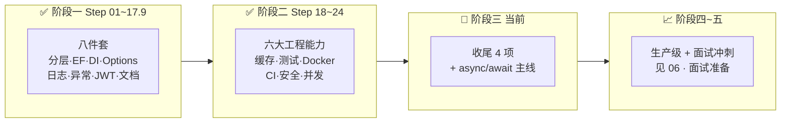

# OrderManagement 学习笔记与路线图

> 整理时间：2026-11-05（初版） · 2026-11-17（第二版：拆分多页 + Step 18~24 + 高级岗位补充）
> 项目：ASP.NET Core 10 订单管理 Web API（学习项目）
> 学习周期：2026-11-02 ~ 2026-11-17 · 9 个 EF 迁移 · 主线 Step 01 → 24 · 累计 13 个 ChatGPT 对话
> 当前状态：**24/25 测试通过**（1 个失败为乐观并发改造未适配）、13 个文件未提交

---

## 📖 文档导航（6 个专题页）

| 页面 | 内容 | 适合场景 |
| --- | --- | --- |
| [01 · 核心知识点-基础篇](01-核心知识点-基础篇.md) | 项目总览 + 第一阶段 9 大主题：分层/DI/EF Core/Options/Serilog/异常/JWT/OpenAPI/状态码 | 复习基础八股 |
| [02 · 工程化进阶-Step18-24](02-工程化进阶-Step18-24.md) | 第二阶段 7 个新知识：Redis 缓存/Repository/测试/Docker/限流健康检查/乐观并发/代码质量 | 复习工程化实践 |
| [03 · 问题清单与学习路线图](03-问题清单与学习路线图.md) | 已解决/待办问题清单 + 五阶段路线图（含下一主线 async/await） | 规划下一步 |
| [04 · 常用命令与速查](04-常用命令与速查.md) | 日常命令 + 验证路径 + CI/部署速查 | 每天开工前查 |
| [05 · 学习对话索引](05-学习对话索引.md) | 13 个 ChatGPT 链接全索引 + 两批对话要点摘要 | 回溯原始对话 |
| [06 · 高级岗位与面试准备](06-高级岗位与面试准备.md) | **自主补充**：高级岗位技术地图（8 大领域）+ 2026 面试策略/考点清单/准备节奏/简历写法 | 面试冲刺 |

---

## 📍 一句话总览

> **当前进度锚点**：主线已到 Step 24（幂等性表设计），ChatGPT 指定的下一主题是 **async/await、Task 与线程池**；
> 最优先的两件小事：**修复失败的 `UpdateAsync` 测试**、**提交 13 个未提交文件**（详见 [问题清单](03-问题清单与学习路线图.md)）。

---

## 🔧 本项目已落地的 15 个主题

| # | 主题 | # | 主题 |
| --- | --- | --- | --- |
| 1 | 分层架构（Controller→Service→Repository） | 9 | Redis 分布式缓存（Cache-Aside + 空值缓存） |
| 2 | EF Core 数据访问与迁移 | 10 | 测试体系（xUnit + Moq + 集成测试） |
| 3 | DI 三种生命周期 | 11 | Docker 化（多阶段 + Compose + 数据卷） |
| 4 | Options 配置模式 | 12 | CI/CD（GitHub Actions） |
| 5 | Serilog 结构化日志 | 13 | 限流 + CORS + 健康检查 live/ready |
| 6 | 全局异常处理 | 14 | 乐观并发（xmin → 409 Conflict） |
| 7 | JWT 认证 + 策略授权 | 15 | 代码质量（Roslyn + CodeQL + 漏洞扫描） |
| 8 | OpenAPI / Swagger | | |
